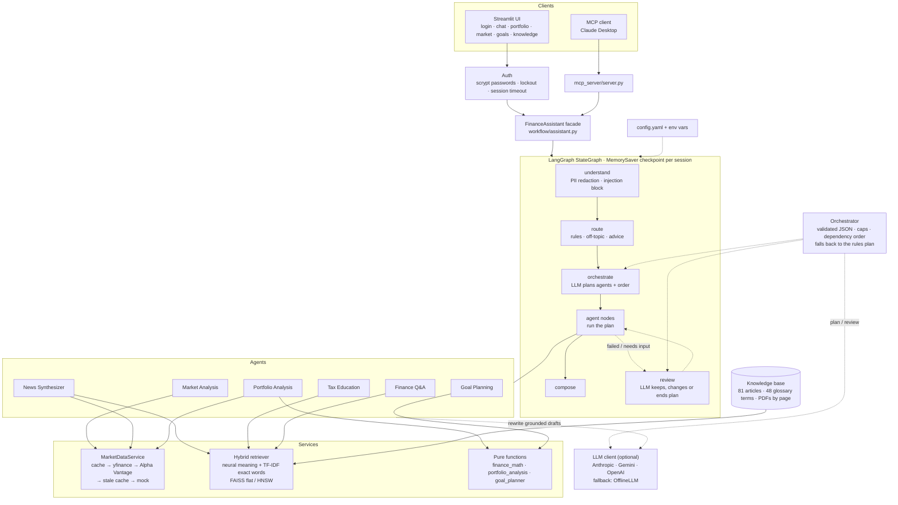
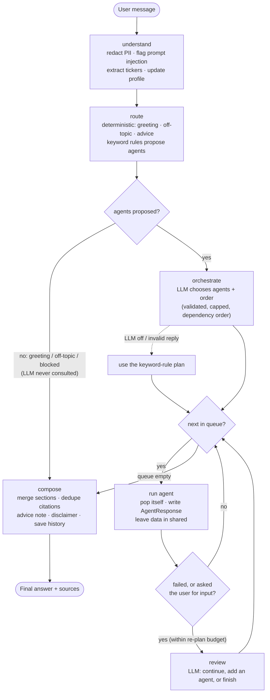
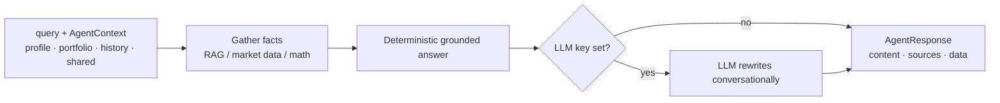

# Architecture and flow

Diagram sources (Mermaid) and rendered images live in [diagrams/](diagrams/). Regenerate with
`npx -y @mermaid-js/mermaid-cli -i diagrams/<name>.mmd -o diagrams/<name>.svg`.

## System architecture

## Request flow (one chat turn)

### The orchestrator

`orchestrate` and `review` are the LLM-driven part ([src/workflow/orchestrator.py](../src/workflow/orchestrator.py)). The LLM controls
**control flow only** - which agents run, in what order, and whether to carry on after a problem. It never writes the answer: agents
still compute grounded facts and the LLM only optionally rewrites them.

| Step | Trigger | LLM call | If the LLM is off or its reply is unusable |
|---|---|---|---|
| `orchestrate` | every message the deterministic checks let through | 1 (plan) | the keyword-rule plan runs unchanged |
| `review` | an agent failed, or asked the user for input (or every agent with `review_every_step`) | 1 per review, at most `max_replans` (2) | the remaining plan continues unchanged |

Safeguards: replies must be JSON naming known agents; repeats and unknown names are dropped; at most `max_agents` (3) agents are
planned, plus one substitute after a failure; `portfolio_analysis` always runs before `goal_planning`; the user's message is passed
as quoted JSON data; and greetings, off-topic messages, advice flags, PII redaction and prompt-injection blocking happen
deterministically *before* the LLM is consulted. Set `orchestrator.mode: rules` for the previous keyword-rules-only behaviour.

## Inside one agent

