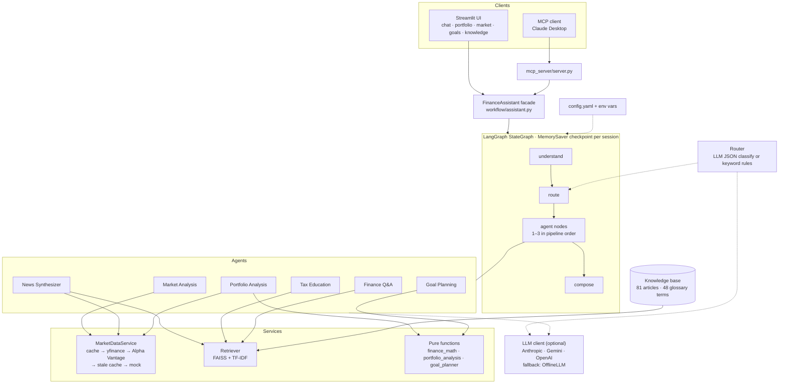
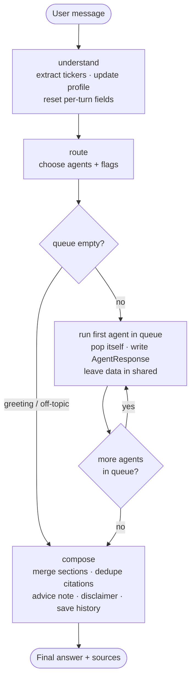
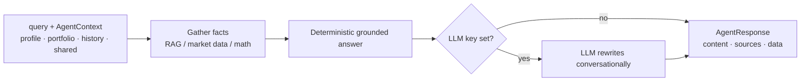

# Architecture and flow

Diagram sources (Mermaid) and rendered images live in [diagrams/](diagrams/). Regenerate with
`npx -y @mermaid-js/mermaid-cli -i diagrams/<name>.mmd -o diagrams/<name>.svg`.

## System architecture

## Request flow (one chat turn)

Multi-intent example: "Analyze my portfolio and plan $100,000 in 10 years" runs the portfolio agent first, which leaves its
equity weight in `shared`; the goal agent reads it, and `compose` merges both sections.

## Inside one agent

